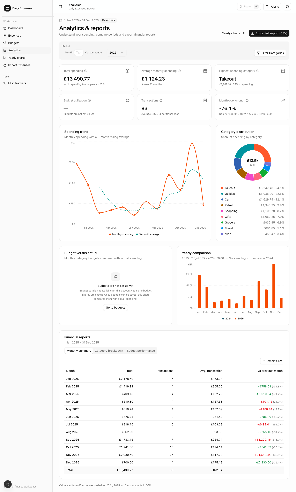
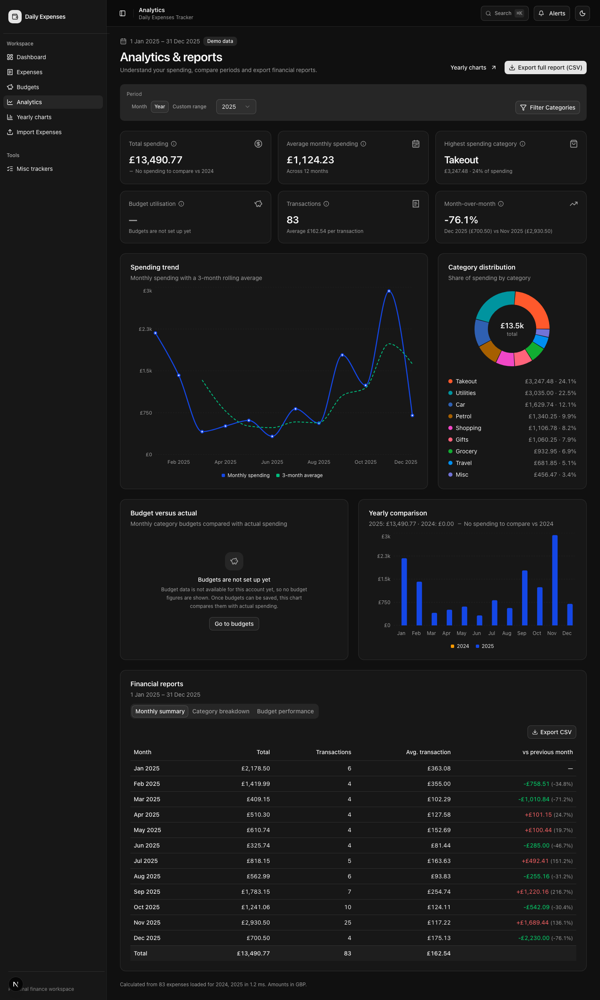
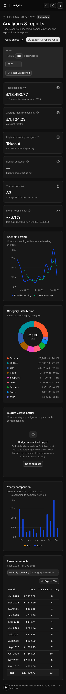

# Feature 6 — Advanced Analytics and Financial Reports

CN7021 coursework · Daily Expenses Tracker · 12 November 2026

## 1. Summary

Feature 6 adds an **Analytics & reports** page (`/analytics`) that turns the signed-in user's
expense and budget records into summary metrics, charts and downloadable reports for any month,
year or custom date range, optionally filtered by category.

All figures come from one pure, unit-tested calculation module (`src/lib/analytics.ts`), so the
summary cards, charts, report tables and CSV exports always agree. The module uses only the
user's own records, loaded under Supabase Row Level Security, and never shows sample figures in
live mode.

| Light theme | Dark theme | Mobile (390 px) |
|---|---|---|
|  |  |  |

*Screenshots use the app's built-in demo dataset (labelled "Demo data"). That dataset only loads
when no Supabase project is configured.*

## 2. Requirements traceability

| Requirement | Implementation |
|---|---|
| **Overview**: total, average monthly, highest category, budget utilisation, transaction count, month-over-month | `AnalyticsOverview.tsx`: six cards, each with a plain-language definition in an accessible tooltip. Total spending also shows the change against the previous equivalent period. |
| **Charts**: monthly line, category donut, budget vs actual, trends, yearly comparison | `SpendingTrendChart` (monthly line plus a 3-month rolling average; daily bars plus a running total for periods of 62 days or fewer), `CategoryDonutChart`, `BudgetVsActualChart`, `YearComparisonChart` |
| **Filtering**: month/year, category, custom range; consistent updates | `AnalyticsFilters.tsx`: Month / Year / Custom range (validated, up to 36 months) and a category filter. Every output is derived from one `buildAnalytics()` result, so all of them update together. |
| **Reports**: monthly summary, category breakdown, budget performance, CSV export | `AnalyticsReports.tsx`: three tables with totals rows and per-report CSV export. The header button exports one combined financial report. |
| **UI/UX**: design system, responsive, themes, skeletons, empty states, tooltips, GBP | Reuses shadcn/ui cards, tabs, tables and tooltips, the existing chart primitives and category colours. Light and dark themes are supported. Skeletons match the final layout, every chart has a helpful empty state, and all money uses `formatCurrency` (`en-GB`, GBP). |
| **Security**: own data only, RLS, no fake live figures | See section 4. |
| **Performance** | See section 5. |
| **Testing** | See section 6. |

The Yearly Charts page already provides member, location and heatmap breakdowns. Rather than
duplicate them, Analytics links to it. Its existing `CategoryFilter`, `YearSelector`,
`MonthYearSelector` and chart primitives are reused.

## 3. Architecture

```
Supabase (RLS: user_id = auth.uid())
   │  paginated, user-scoped reads
   ▼
fetchExpensesBetween()          fetchBudgetsForYears()
   │  one cached query per year      │  status: ready / unavailable / error
   ▼                                  ▼
useQueries(["yearly-expenses", y])   useBudgetsForYears()
   └──────────────┬───────────────────┘
                  ▼
        useAnalytics(selection, categories)
                  │  useMemo → buildAnalytics()   (pure, src/lib/analytics.ts)
                  ▼
     AnalyticsResult ── overview cards
                     ├─ charts (lazy-loaded Recharts)
                     ├─ report tables
                     └─ CSV builders → downloadCsv()
```

**Design decisions**

1. **A pure calculation core.** `buildAnalytics()` takes plain data and returns every figure the
   page needs. It has no React, network or browser dependencies, so it can be tested
   exhaustively and benchmarked in isolation.
2. **Money in integer pence.** Amounts are summed as whole pence and converted back once.
   Floating-point drift (for example 0.1 + 0.2 ≠ 0.3) therefore cannot make a chart total
   disagree with the records behind it.
3. **Dates as local calendar keys.** Expenses are compared as `"YYYY-MM-DD"` strings, not as
   UTC instants, so an expense on 31 December can never fall into January. This is tested
   explicitly at the year boundary.
4. **Year-granular caching.** Expenses are fetched one calendar year at a time, using the same
   query key as the Dashboard and Yearly Charts, so the three pages share one cache entry.
   Changing the month, category or a range within already-loaded years makes no request.
5. **Honest comparisons.** "Average monthly spending" divides by the months of the period that
   have started, so a year-to-date average is not diluted by future months. A percentage change
   is shown as "no spending to compare" when the previous figure is £0, never as an infinite or
   misleading percentage.
6. **Budget status matches alerts.** Budget-vs-actual reuses Feature 5's `computeThreshold`
   (80% warning, 100% at limit, over 100% over budget), so the analytics and the spending alerts
   can never disagree. Each monthly budget is compared only with spending in that same month and
   category.

## 4. Security

- **Database enforcement:** Row Level Security (`user_id = auth.uid()`) restricts every read to
  the signed-in user. The new reads add an explicit `user_id` filter as defence in depth, and
  make no request at all without a session.
- **Route protection:** `/analytics` is behind the existing middleware and protected layout.
  An anonymous request returns `307 → /login?next=/analytics` (verified).
- **Cross-user cache leak, found and fixed:** the client-side query cache survived sign-out. On a
  shared browser tab, a second user could briefly have seen the first user's cached expenses.
  The cache is now cleared whenever the signed-in user changes (`src/app/providers.tsx`).
- **No invented figures:** live mode never uses the demo dataset. While the `budgets` table
  migration is unapplied, budget cards and charts say "Budgets are not set up yet" instead of
  showing £0 or placeholder values.
- **Safe CSV export:** files are generated in the browser from data already on screen, so
  nothing is uploaded. Cells beginning with `=`, `+`, `-` or `@` are neutralised to prevent
  spreadsheet formula injection (CWE-1236). This is unit-tested.
- No database tables, migrations, policies or authentication code were changed.

## 5. Performance

| Measure | Result |
|---|---|
| First-load JavaScript (production build) | `/analytics` **266 kB**, vs Dashboard 323 kB and Yearly Charts 309 kB (Recharts is lazy-loaded) |
| Dev compile (Turbopack) | 2.0 s cold, 83 ms warm |
| Aggregation in the browser (83 records) | 0.2–1.6 ms, shown under the page |
| Aggregation benchmark (`npm run bench:analytics`, median of 25 runs) | 1,000 records: 0.1–0.4 ms · 10,000: 0.8–3.7 ms · 50,000: 4.5–18.9 ms |
| Network | One query per calendar year plus one budgets query. Filter changes inside loaded years: 0 requests. |

Rendering is kept efficient by computing everything in a single memoised pass. Chart and report
components are wrapped in `React.memo` and receive stable props. While a newly selected year
loads, the previous result stays visible (dimmed), so the page doesn't flash back to skeletons.

**Correctness fixes made along the way**
- The yearly fetch is now paginated. PostgREST returns at most 1,000 rows per request, so large
  years were previously truncated without warning.
- Expense edits now refresh the yearly caches, so the Dashboard, Yearly Charts and Analytics no
  longer show stale totals for up to five minutes.

## 6. Testing

| Suite | Result |
|---|---|
| Unit tests (`npm test`) | **327 passed, 0 failed**: 84 new analytics tests plus 243 existing tests, all still passing |
| TypeScript (`npx tsc --noEmit`) | 0 errors (two pre-existing errors fixed) |
| ESLint, new and changed files | 0 errors |
| Browser (headless Edge via the DevTools Protocol) | All seven app pages load with no console errors. Charts render in light, dark and mobile layouts. Filters and CSV download were verified. |

The 84 analytics tests cover:
- **Calculations:** pence-exact sums, refunds, percentage change with a zero baseline.
- **Date filtering:** inclusive boundaries, 31 December vs 1 January, leap years, daylight-saving
  changes, reversed and over-long custom ranges.
- **Reconciliation:** monthly, daily, category and CSV totals each equal the sum of the
  underlying records.
- **Empty datasets:** zeros and "no data" states, never `NaN`.
- **Budgets:** month-by-month matching, thresholds, the "unavailable" state.
- **Year boundaries:** December → January month-over-month, year-on-year alignment.
- **CSV:** escaping and formula-injection protection.

In the browser on the demo dataset, the Total spending card, the monthly report total and the
sum of the months all equal £13,490.77 (83 transactions). Excluding Takeout gives £10,243.29,
which is £13,490.77 − £3,247.48.

## 7. Limitations and future work

- **Budgets:** budget-vs-actual activates once the pending `budgets` table migration is applied.
- **Pre-existing build blockers:** `next build` currently fails on ESLint errors in 17 earlier
  files, and because `/login` uses `useSearchParams()` without a `<Suspense>` boundary. None of
  these are Feature 6 code. With both bypassed, the production build succeeds.
- **Summer-time date shift:** saving an expense during British Summer Time currently stores the
  previous day, because dates go through `toISOString()`. This is a pre-existing defect in
  expense saving, documented in `docs/ERROR_LOG.md`, and analytics adds no shift of its own.
- **Future work:** server-side aggregation (a Postgres view or RPC) would let ranges far beyond
  50,000 records be summarised without downloading the raw rows. A PDF version of the financial
  report could also reuse the Yearly Charts print stylesheet.
