# UI/UX redesign

The application is being redesigned in eight controlled stages. Each stage
ends with type checking, linting, unit tests and browser checks at 375, 768,
1024 and 1440 px in light and dark mode. Measurements are in
[PERFORMANCE_REPORT.md](PERFORMANCE_REPORT.md), and problems found are in
[ERROR_LOG.md](ERROR_LOG.md).

| Stage | Scope | Status |
|---|---|---|
| 1 | Audit, npm check, Git checkpoint, baseline measurements | Done |
| 2 | Design system, shared components, shared layout | Done |
| 3 | Authentication pages and navigation | Next |
| 4 | Dashboard and expenses | — |
| 5 | Budgets, spending alerts, analytics | — |
| 6 | Trackers, imports, AI insights | — |
| 7 | Performance, responsiveness, accessibility | — |
| 8 | Full regression testing and documentation | — |

Git checkpoint before any redesign work: commit `cf33ddf`, tag
`checkpoint/pre-redesign-2026-11-12`.

## Design goals

An original, calm fintech interface: minimal chrome, clear hierarchy, numbers
that are easy to scan, and colour that carries meaning rather than decoration.
It takes inspiration from the restraint of developer and finance dashboards
without copying any product's layout, assets or branding.

Principles:

1. **Colour means something.** Emerald is the brand and "positive"; amber is
   "approaching a limit"; red is "over the limit or an error". Data series in
   charts use neutral hues, so a spending line is never green ("good").
2. **Never colour alone.** Every status pairs colour with a word, an icon or a
   sign (e.g. `↗ +12.6%`).
3. **One pattern per job.** One page header, one stat tile, one empty state,
   one error state, used everywhere.
4. **Fast by default.** Zero web-font bytes, no new dependencies, and shared
   components that add no client JavaScript unless a page uses them.

## Stage 2: the design system

### Colour tokens

Defined once in `src/app/globals.css` as CSS variables (OKLCH), and exposed
to Tailwind as utilities (`bg-success`, `text-warning`, `bg-chart-1`, …).

| Token | Light | Dark | Use |
|---|---|---|---|
| `background` | `#faf9f7` warm off-white | `#0f0e0d` charcoal | Page |
| `card` | `#ffffff` | `#171514` | Cards, tables |
| `foreground` | `#191714` warm charcoal | `#f4f3f1` | Body text |
| `muted-foreground` | `#67625e` | `#a6a29e` | Secondary text |
| `primary` | `#007851` deep emerald | `#48ce99` bright emerald | Brand, primary actions, focus |
| `success` | `#007750` | `#4cd19c` | Positive values, healthy budgets |
| `warning` | `#a54f00` | `#f7b83d` | 80 % spending threshold |
| `destructive` | `#c92324` | `#f7615f` | 100 % threshold, errors, delete |
| `info` | `#0e6ab4` | `#6db0f4` | Neutral notices |

Hex values are the rendered sRGB of the OKLCH tokens.

**Contrast (computed, WCAG 2.x):** every text pair passes AA (≥ 4.5:1) in
both themes. That covers foreground, muted and semantic text on page, card,
muted and hover surfaces, white text on the primary button, and each semantic
colour on its own 10 % tint (the badge background). For example, muted text
on the page background is 5.72:1 light and 7.62:1 dark, and warning text on
its tint is 4.90:1 light. The light warning colour was darkened twice until it
passed on its tint (4.36 → 4.90).

### Chart palette

`--chart-1…5` follow a categorical order validated for colour-vision
deficiency. It was checked with the data-visualisation validator against the
app's own card surfaces (`#ffffff` light, `#171514` dark).

| Slot | Hue | Light | Dark |
|---|---|---|---|
| 1 | blue | `#2a78d6` | `#3987e5` |
| 2 | orange | `#eb6834` | `#d95926` |
| 3 | aqua | `#1baf7a` | `#199e70` |
| 4 | yellow | `#eda100` | `#c98500` |
| 5 | magenta | `#e87ba4` | `#d55181` |

- Adjacent pairs pass the colour-vision-deficiency check (worst ΔE 9.1 light,
  8.4 dark; target ≥ 8) and the normal-vision floor (19.6 / 19.3; ≥ 15).
- The first three slots also pass when every pair is compared. Existing
  charts only combine 1+2 (trend + rolling average) and 1+3 (year
  comparison).
- In light mode slots 3–5 are below 3:1 against white. Charts using them must
  show visible labels or a table view. Analytics already has report tables;
  Stage 5 will check each chart.
- Previously `chart-1` was orange in light mode and violet-blue in dark mode,
  so the same series changed colour with the theme. Both themes now use the
  same hue per slot.

### Typography

- **System font stack** (San Francisco on Apple devices, Segoe UI on Windows):
  0 bytes downloaded, no layout shift, works offline. Google-hosted fonts had
  previously broken offline builds.
- Page title 28 px (24 px on mobile) at weight 600; card titles 16 px/600;
  body 14 px; captions 12 px. Tight tracking on headings; `text-wrap: balance`
  on h1–h3.
- **Tabular figures** for every money value (`<Money>`), stat value and table
  cell, so columns of amounts line up digit by digit.

### Shape and elevation

- Radius 10 px base (cards 14 px, controls 8 px).
- Softer, layered shadows (`shadow-xs` → `shadow-lg`) in light mode. In dark
  mode surfaces are separated by tone and 8 % white hairlines instead.

### Shared components (`src/components/shared/`)

All are plain components (no hooks, no `"use client"`), so they work in
server and client components and add no JavaScript to pages that do not use
them.

| Component | Purpose | Key props |
|---|---|---|
| `PageHeader` | One title pattern for every page | `title`, `description`, `eyebrow`, `actions` |
| `StatCard` / `StatCardSkeleton` | Summary metric tile | `label`, `value`, `icon`, `hint`, `delta { value, goodDirection, label }`, `children` |
| `Money` | Formatted GBP with tabular figures | `amount`, `tone`, `signed`, `compact` |
| `Meter` | Accessible progress bar (`role="progressbar"`, real `aria-valuetext`) | `value`, `max`, `label`, `tone="auto"` |
| `StatusBadge` | Tinted status label built on the shadcn/ui `Badge` | `tone`, `dot` |
| `EmptyState` | Icon, heading, guidance and next action | `icon`, `title`, `description`, `actions`, `variant` |
| `ErrorState` | Recoverable error (`role="alert"`) with retry | `title`, `message`, `onRetry`, `retrying`, `actions` |

Design decisions:

- `Meter` colours come from the same constants as spending alerts
  (`ALERT_THRESHOLDS`: warning ≥ 80 %, critical ≥ 100 %), so a budget bar and
  its alert can never disagree. Over-budget values show a full bar but announce
  the true percentage (e.g. "130%").
- `StatCard` deltas take a `goodDirection`, because for spending a decrease is
  good news. Each delta shows an arrow, a sign and a colour.
- `Money` never colours amounts automatically, because an expense is not
  inherently "bad". The caller chooses the tone.
- shadcn/ui primitives in `src/components/ui/` were **not edited**. The new
  look comes from tokens, and variants are composed in `shared/`.

### Shared layout (`src/app/(protected)/`)

| Change | Why |
|---|---|
| "Skip to content" link | Keyboard users can bypass the sidebar and header |
| Header and `<main id="main-content">` as sibling landmarks (the header was previously inside `<main>`) | Correct landmark structure for screen readers |
| Sidebar collapsed/expanded state restored from its cookie on the server | The cookie was written but never read, so the sidebar always reopened |
| Alerts receive the verified user id from the server layout | Removes a browser round-trip to Supabase Auth on every page load |
| `loading.tsx` with a skeleton | Instant feedback on navigation; enables partial prefetching of dynamic routes |
| `error.tsx` boundary | A rendering error shows a recoverable message inside the app shell instead of a blank screen |
| Content width 1440 px | More readable line lengths on large screens |
| `theme-color` meta (light and dark) | Mobile browser chrome matches the app background |
| `color-scheme` per theme | Native scrollbars and form controls follow the theme |

### Design-system reference page

`/design-system` renders every token and shared component. It is for
development only: it is not in the navigation, and production builds show the
"page not found" screen in its place. Its figures are labelled as
illustrative and are not read from the database.

### Accessibility in Stage 2

- WCAG AA text contrast in both themes (computed, above).
- Visible focus: emerald focus rings on controls, plus a 2 px outline for plain
  links and custom focusable elements.
- The reduced-motion rule is kept. Meters animate width only, and the rule
  disables that animation.
- Status colours are always paired with text or icons.

### Screenshots

Before (commit `cf33ddf`) and after Stage 2. Demo mode, headless Edge.

| View | Before | After Stage 2 |
|---|---|---|
| Dashboard, 1440 px light | 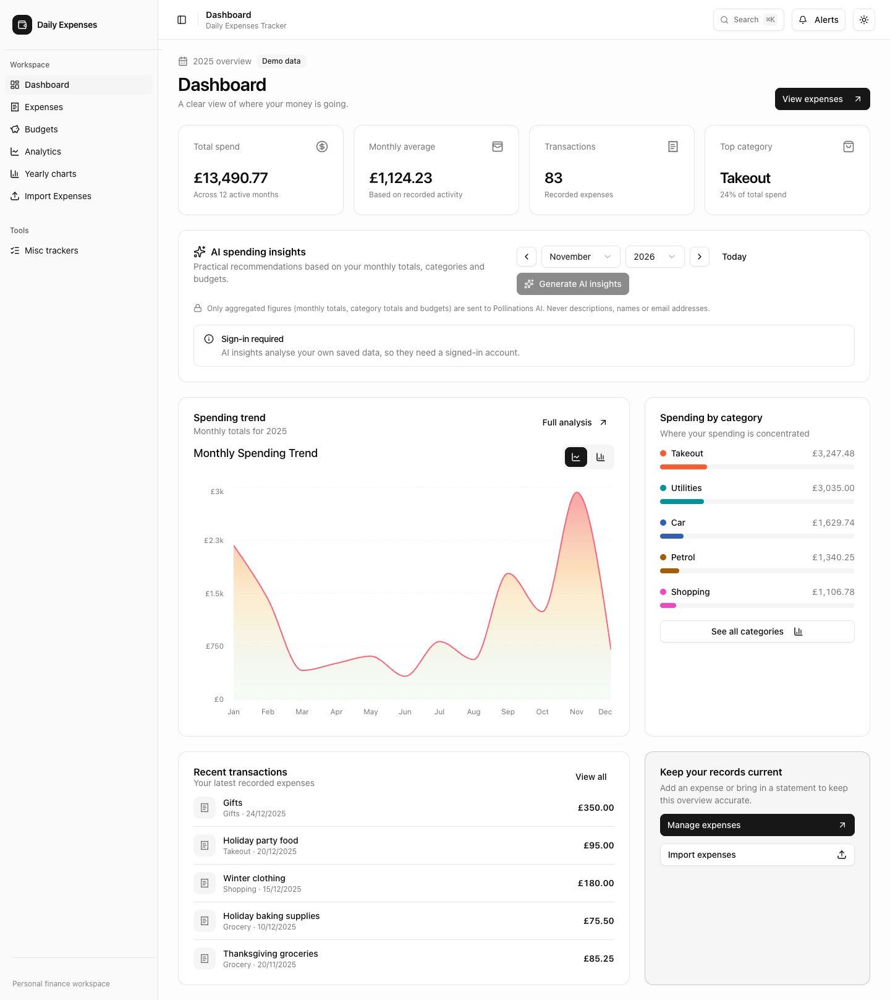 | 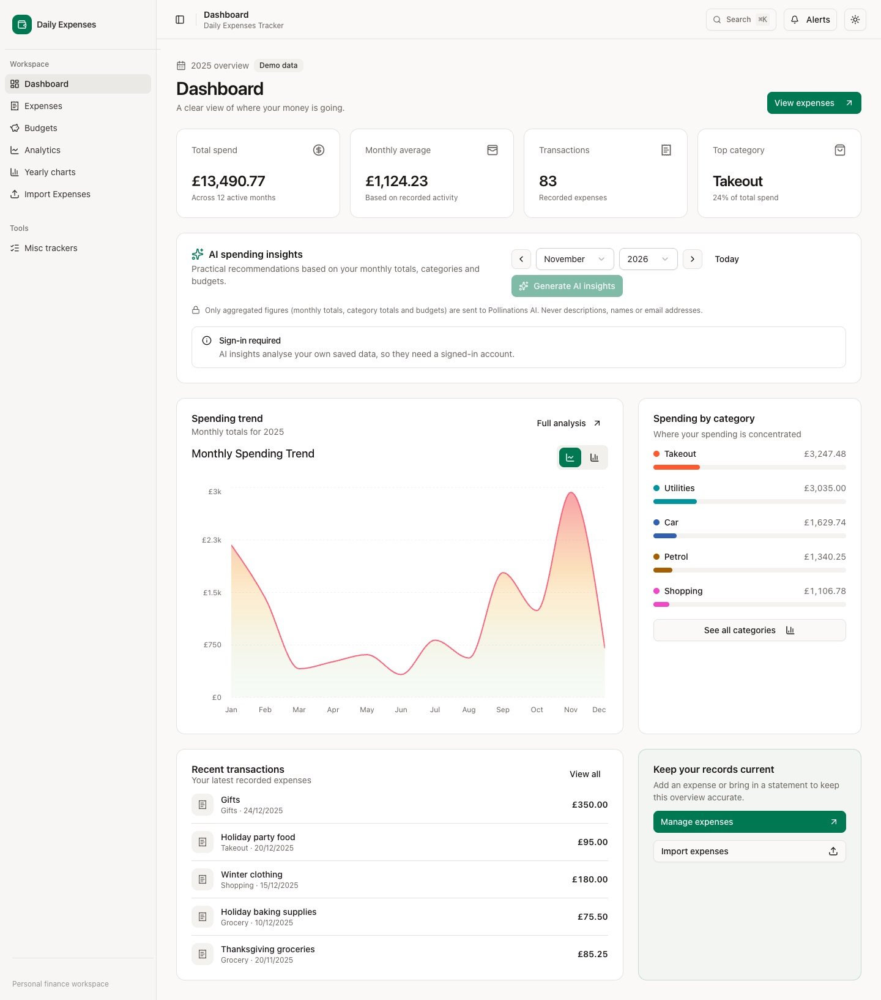 |
| Dashboard, 1440 px dark | 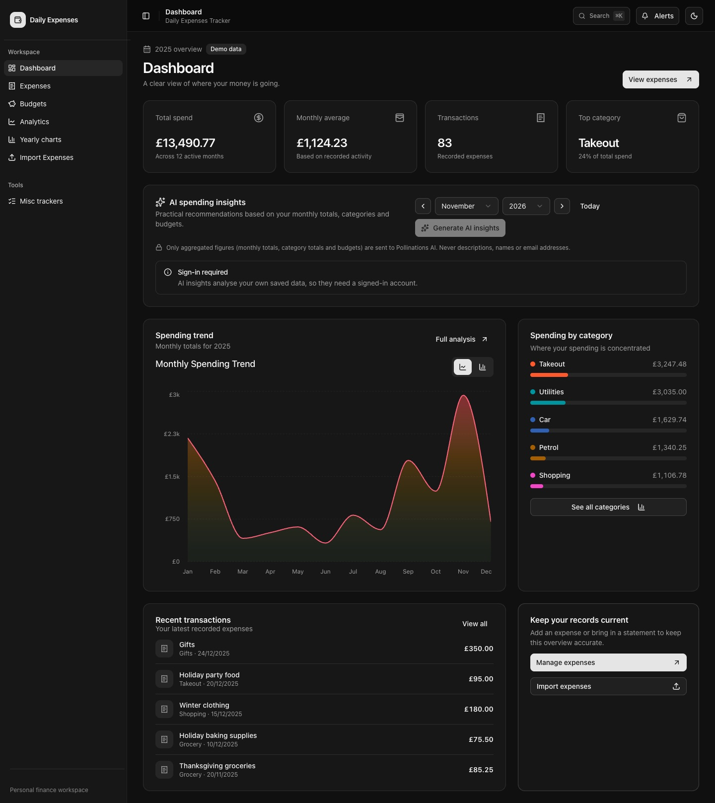 | 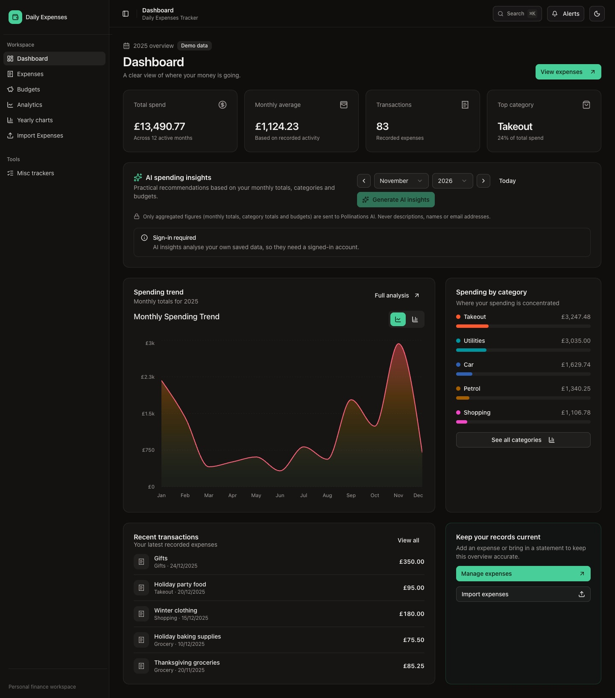 |
| Dashboard, 375 px | 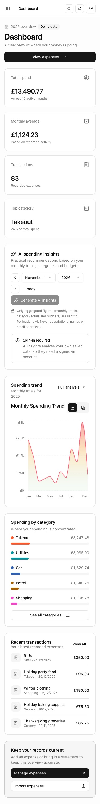 | 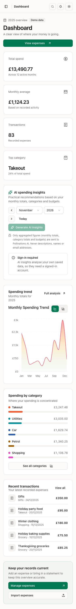 |
| Budgets, 1440 px | 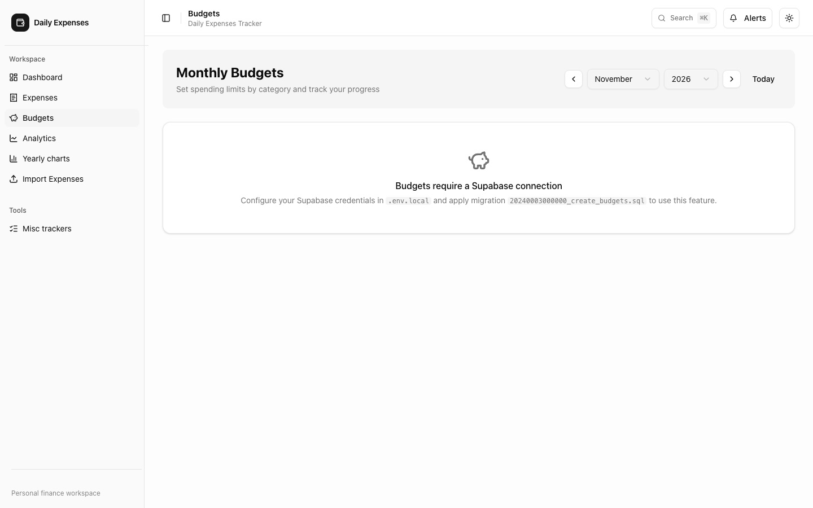 | 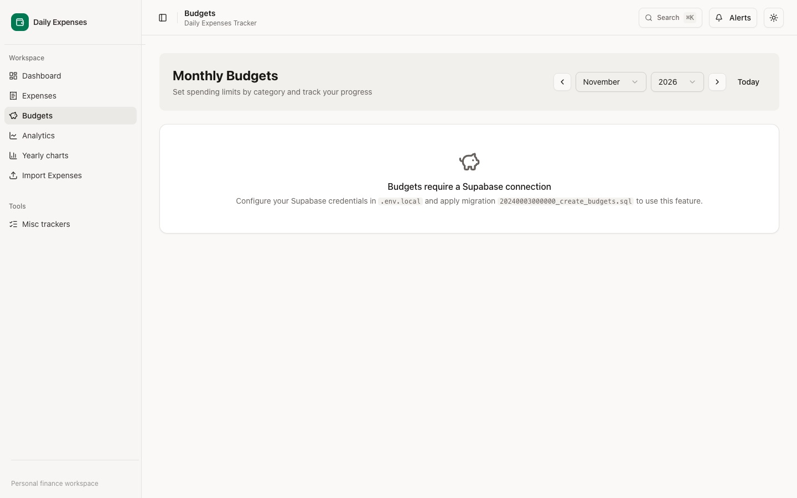 |
| Expenses, 1440 px | 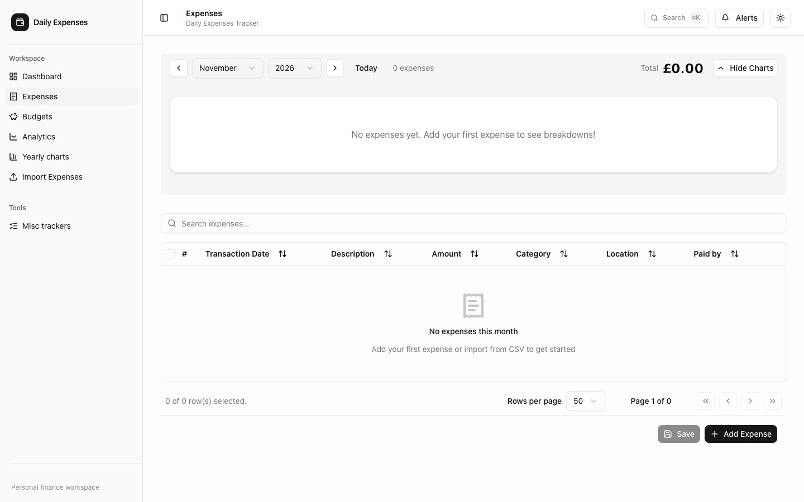 | 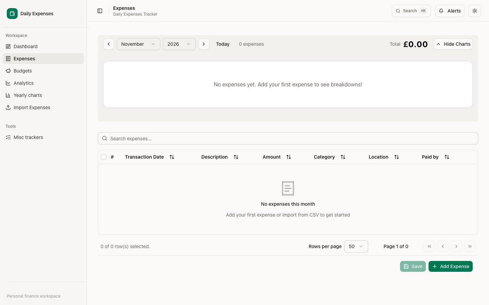 |
| Login, 1440 px | 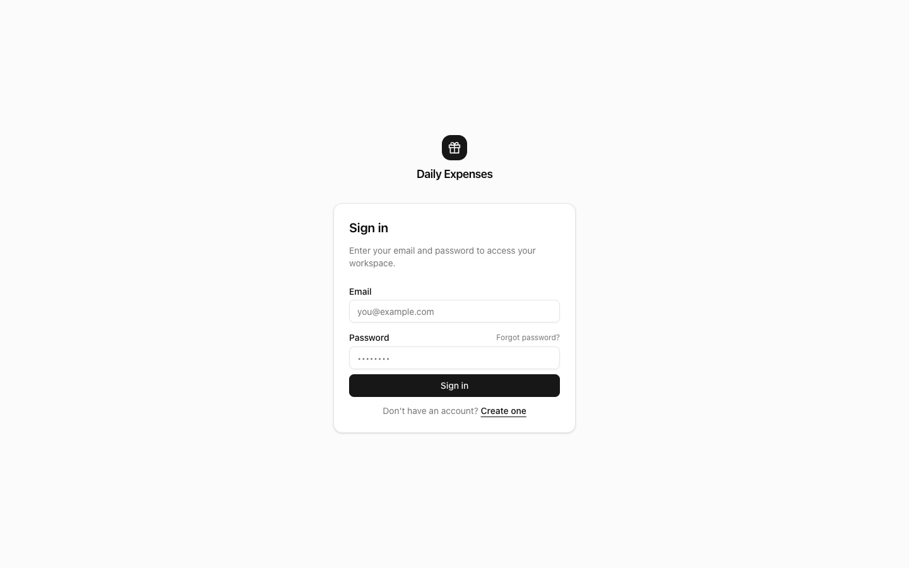 | 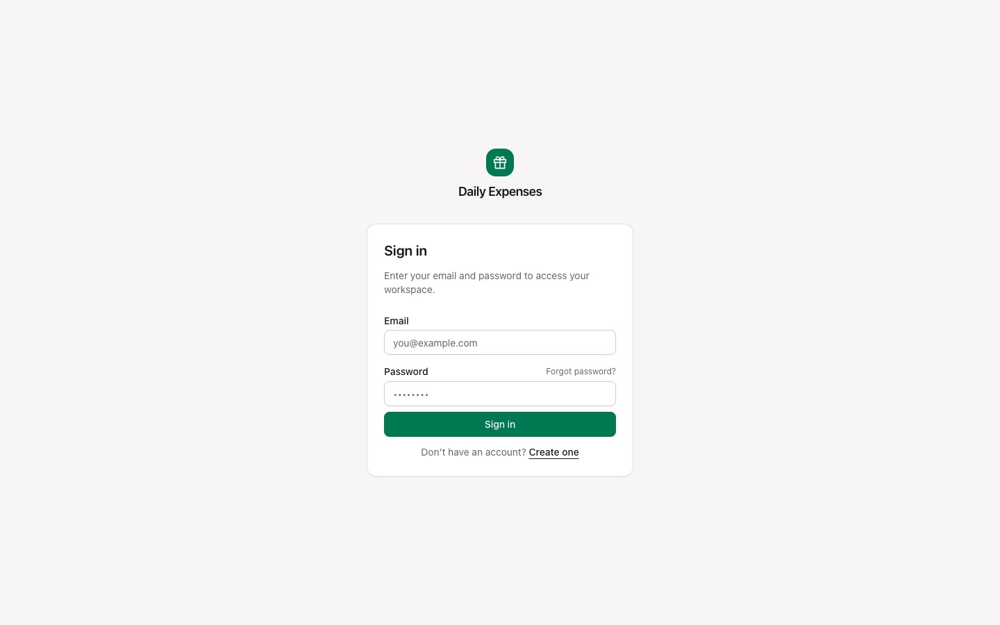 |

Design-system reference:
[light](images/redesign/after-stage2/design-system-1440-light.jpg) ·
[dark](images/redesign/after-stage2/design-system-1440-dark.jpg) ·
[375 px light](images/redesign/after-stage2/design-system-375-light.jpg) ·
[375 px dark](images/redesign/after-stage2/design-system-375-dark.jpg)

Existing pages already use the new tokens (emerald actions, warm surfaces,
charcoal dark mode). Their layouts are redesigned page by page in Stages 3–6.

### Known limitations after Stage 2

- Input borders are 1.56:1 against cards in light mode, a common pattern but
  below the 3:1 non-text guideline. Fields always have visible labels, and on
  focus the border becomes the solid ring colour (3.7:1 light, 7.2:1 dark).
- The light-mode warning colour is a deep amber chosen for text contrast. As a
  bar fill it reads as burnt orange.
- Inconsistencies seen in the baseline and not yet changed (planned for later
  stages): page headers differ between pages; the navbar repeats the page
  title; the login logo (gift icon) does not match the sidebar logo (wallet);
  the command palette is missing Budgets; the Budgets demo message names the
  superseded migration `20240003`; demo-mode Expenses opens on an empty month
  and shows "Page 1 of 0".
